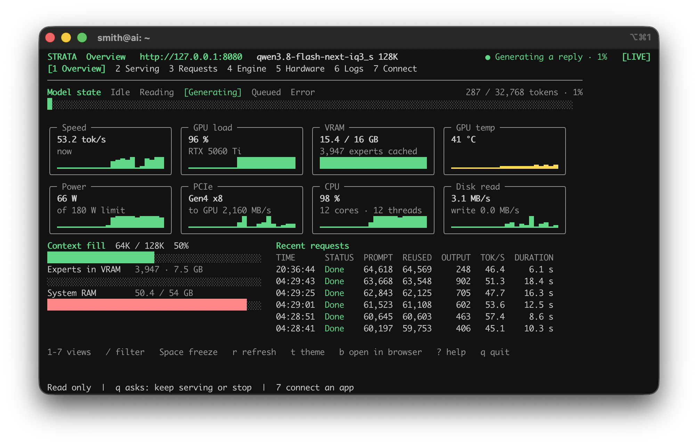
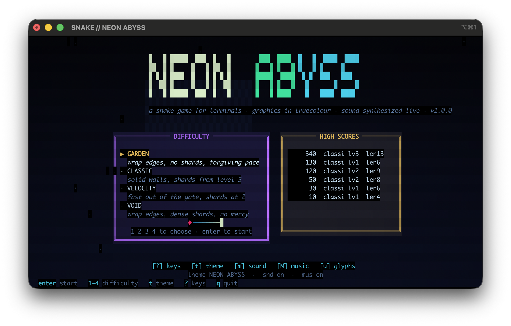
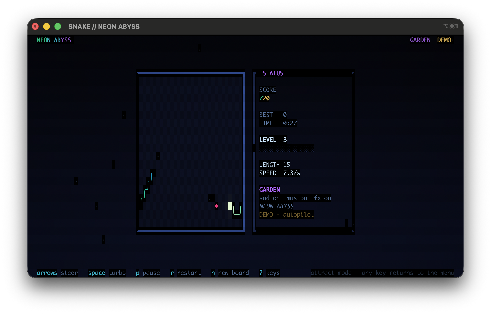
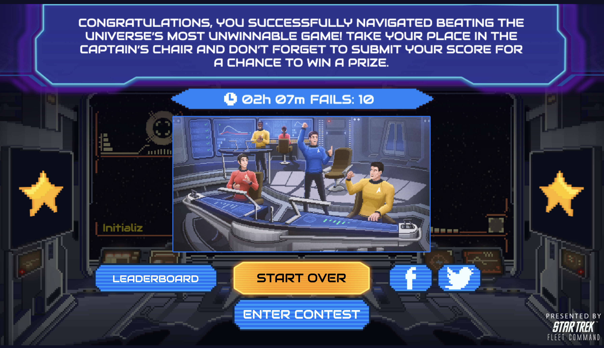



The story starts last year. I wanted to build a personal assistant. I had been experimenting with local models and figured that with the right hardware I might be able to get a basic one running. At the time, that turned out to be wildly ambitious: the models I could run on the RTX 5060 Ti I bought couldn't follow instructions or respond fast enough to be usable, even as a basic coding assistant. I ended up using the machine to stream Satisfactory to my Steam Deck more than anything else.

Fast-forward to October 2026, and I started hearing interesting things about [Strata](https://github.com/niko1221/strata). Within an hour I had `qwen3.8-flash-next-iq3_s` running at about 50 tokens/s. I connected up [pi](https://pi.dev/) and had it build [a snake game](https://github.com/pcorliss/snake-terminal-experiment). With no extra prompting it produced a working first pass; a second pass fixed the music and sound effects. An impressive start.

## Kobayashi Maru

I dug through my `~/git` directory looking for half-finished projects and found the archive of the [Kobayashi Maru Game](https://www.startrek.com/news/the-kobayashi-maru-hits-the-web) I had pulled from the [Wayback Machine](https://web.archive.org/web/20260000000000*/kobayashimaru.com). Back in 2021 I'd played this browser game, figured out the path to beat it, and won a lifetime subscription to [Paramount+](https://www.paramountplus.com/). The Facebook integration broke after about a year, and the DNS stopped resolving around 2025. I made a half-hearted attempt to get the archive running without the Facebook integration, but the obfuscated JS was more than I could take on.

Reading about other people using LLMs to port/emulate games made me think this was a good chance to see how far I could get. With a single prompt we were off: after a short while it had deobfuscated the JS, analyzed it, and written scripts to rewrite the links and build an offline version. Given more time it built a shim for Facebook login. It also decided there were bugs in various places, and that it would helpfully "fix" them by adding more shims. At that point I had to pause it: it was taking on unasked-for features.

With a little direction I had it on GitHub, [github.com/pcorliss/kobayashi_maru](https://github.com/pcorliss/kobayashi_maru), and hosted on GitHub Pages at [blog.50projects.com/kobayashi_maru/](https://blog.50projects.com/kobayashi_maru/).

Total time was two to three hours, most of it unmonitored.

## Where the LLM failed

The LLM and harness got hyper-fixated on building a full testing framework based on headless Chrome. It tried to fix the failure counter, which it had classified as a bug in the original game, and which turned out to be a misreading of the code.

I hadn't played it in five years, so I had only vague memories of the tricks for beating it. The game had originally been marketed as "impossible," and the designers had planted plenty of blind paths and requirements for reaching the good ending. So I asked it to analyze the code and work out the path to the end. After several hours it had written a script and was trying to brute-force the game by walking every story path. I dug up my old notes from the first time I played and handed it the path I had taken. It still couldn't solve it.

It would be an interesting experiment to see whether a state-of-the-art model from Anthropic or OpenAI would do better. For the moment, though, I'm enjoying the John Henry moment of still being better at something than the machine, even if it's just a video game.

## Takeaways

- This is the most impressed I've been with local LLMs so far. On just 16 GB of VRAM, 64 GB of RAM, and fast disk, I was able to run a full-fledged harness with thinking support.
- In my day job I work as a [Platform Engineer at a trading company](https://www.linkedin.com/in/philipcorliss), and I use Claude Opus 5.5 heavily. Stepping back to a weaker model made me appreciate both what the paid models offer and what I can get from local hardware.
- This local model doesn't compare to Opus 5.5, but it's better than what I was running a year ago, and I'm hopeful local LLMs keep tracking less than a year behind the best paid models.

## My LLM Machine Specs

- CPU: AMD Ryzen 5 9600X
- RAM: 64 GB DDR5
- GPU: Nvidia RTX 5060 Ti, 16 GB
- Drive: 1 TB NVMe
- Model: `qwen3.8-flash-next-iq3_s`

## Play it

Play the game at [blog.50projects.com/kobayashi_maru/](https://blog.50projects.com/kobayashi_maru/).